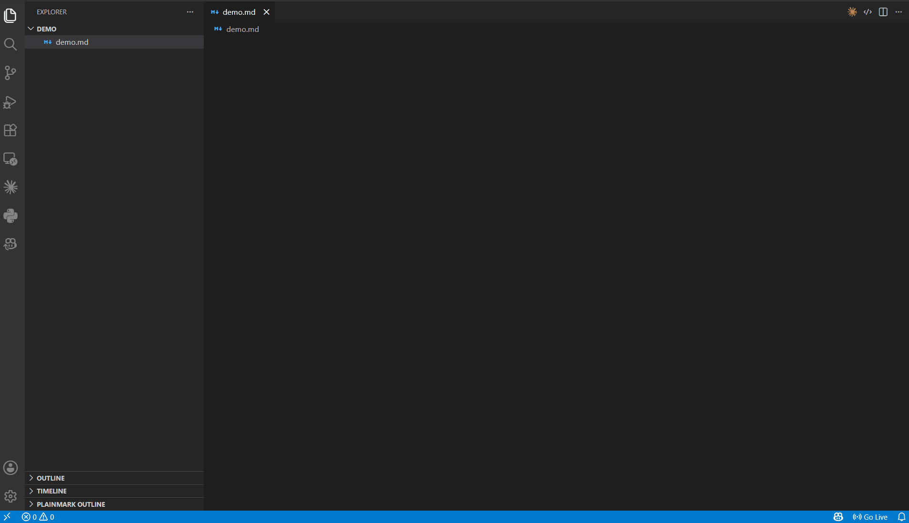
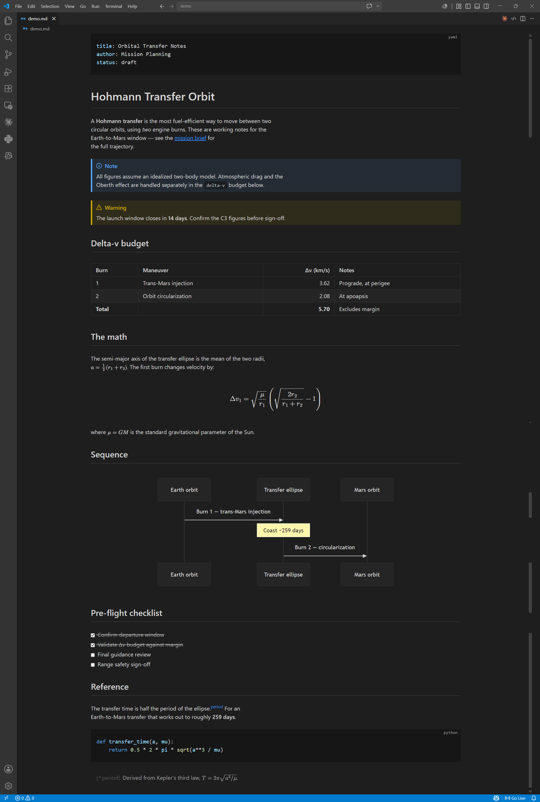

# Plainmark

**A free, WYSIWYG Markdown editor for VS Code Desktop and vscode.dev.** Obsidian-style live preview — formatting renders inline as you type — without leaving your editor, and without a paywall.

[](https://marketplace.visualstudio.com/items?itemName=tutivog.plainmark)
[](https://marketplace.visualstudio.com/items?itemName=tutivog.plainmark)
[](https://marketplace.visualstudio.com/items?itemName=tutivog.plainmark)
[](./LICENSE)



Works the same in VS Code Desktop and in the browser (vscode.dev, github.dev).

## Features

- **Live preview** — headings, emphasis, links, lists, quotes, and code render inline; Markdown markers show only on the caret's line. Links open with `Ctrl/Cmd+click`.
- **Tables** — visual editing: insert, delete, and move rows and columns, set alignment, select and copy blocks of cells, with configurable shortcuts. Tables also work inside quotes and callouts — put a bare `>` line between the quoted text and the header row.
- **Math and diagrams** — LaTeX via MathJax (inline and block) and Mermaid diagrams.
- **Callouts** — Obsidian-style `> [!NOTE]`; `[!NOTE]-` starts folded, `[!NOTE]+` open.
- **Full Markdown** — footnotes, autolinks, images, frontmatter, and HTML.
- **Smart paste** — images are saved into your workspace and linked; spreadsheet ranges and web tables become Markdown tables; formatted text from chat answers, web pages, or Word arrives as Markdown; multi-line pastes into a quote keep their `>` markers.
- **Right-click menu** — format, turn lines into headings, lists, or quotes, and insert tables, code, math, rules, and footnotes.
- **Find and replace** — `Ctrl/Cmd+F` searches the whole document, tables included, with a match count.
- **Outline, word count, CJK-aware word navigation** — Explorer outline, live status-bar word count, and word jumps and deletion that understand unspaced Chinese and Japanese.
- **Theming** — built-in light/dark themes plus your own CSS.



## Your files stay yours

Plainmark never rewrites what you didn't touch: every edit is byte-preserving outside the range you change, verified end-to-end (open → edit → save → re-read) and fuzz-tested on both the desktop and web builds.

## Getting started

1. Install Plainmark from the [VS Code Marketplace](https://marketplace.visualstudio.com/items?itemName=tutivog.plainmark).
2. Open a `.md` file and click **Open in Plainmark** in the editor title bar, or press `Ctrl/Cmd+Shift+M`.
3. The same shortcut toggles back to the text editor.

## Commands

| Command | Keybinding |
| --- | --- |
| Plainmark: Open in Plainmark / Open in Text Editor | `Ctrl/Cmd+Shift+M` |
| Plainmark: Insert table | — |
| Plainmark: Insert footnote | `Ctrl/Cmd+Shift+6` |
| Plainmark: Normalize list indentation | — |
| Plainmark: Convert to CommonMark | — |
| Plainmark: Compact paragraphs | — |
| Plainmark: Prettify document | — |
| Plainmark: Select Theme | — |

The three blank-line commands each apply as a single undoable edit and skip anything whose meaning a rewrite could change (code blocks, tables, hard line breaks, list interiors, 4-space-indented lines):

- **Compact paragraphs** joins hard-wrapped lines and removes blank lines between blocks — Plainmark's one-line-per-paragraph style.
- **Convert to CommonMark** does the reverse, adding the blank lines (including `>` lines in quotes) other renderers need to keep every paragraph, quote, and list separate.
- **Prettify document** keeps line breaks inside paragraphs and only normalizes the blank lines between blocks; tune it with `plainmark.prettify.seams`.

In Plainmark's compact style, a line without `>` ends a quote, and a numbered item directly under a line of text starts a list whatever its number. **Convert to CommonMark** inserts the blank lines that make other renderers agree.

## Settings

| Setting | Description |
| --- | --- |
| `plainmark.theme` | `default` (follows VS Code), `github-light`, `github-dark`, or `claudify` (warm cream). |
| `plainmark.styles` | Your own CSS files — see the [theming guide](./docs/theming-guide.md). |
| `plainmark.tableKeybindings` | In-table editing shortcuts. |
| `plainmark.imagePasteLocation` | Folder for pasted images (default: next to the document); supports `${documentWorkspaceFolder}` and `${documentBaseName}`. |
| `plainmark.paste.convertTables` | Convert pasted spreadsheet ranges and tables to Markdown (default on). |
| `plainmark.paste.convertRichText` | Convert pasted formatted text to Markdown (default on). |
| `plainmark.prettify.seams` | Blank lines **Prettify document** writes between block pairs, e.g. `{ "table>heading": 0 }`. |

## Known limitations

- **Image paste** needs a saved document on a writable file system (not untitled files or read-only workspaces, including some vscode.dev folders).
- **Custom CSS** accepts local paths and `file:` URIs only; remote stylesheets and fonts are declined.
- **Very large documents** (over ~2 MB) can make typing sluggish; Plainmark suggests reopening them in the text editor.
- **Indented (4-space) code blocks** render as plain text — use fenced ` ``` ` blocks.
- **Links in Mermaid diagrams** don't open.

## License

[MIT](./LICENSE)
